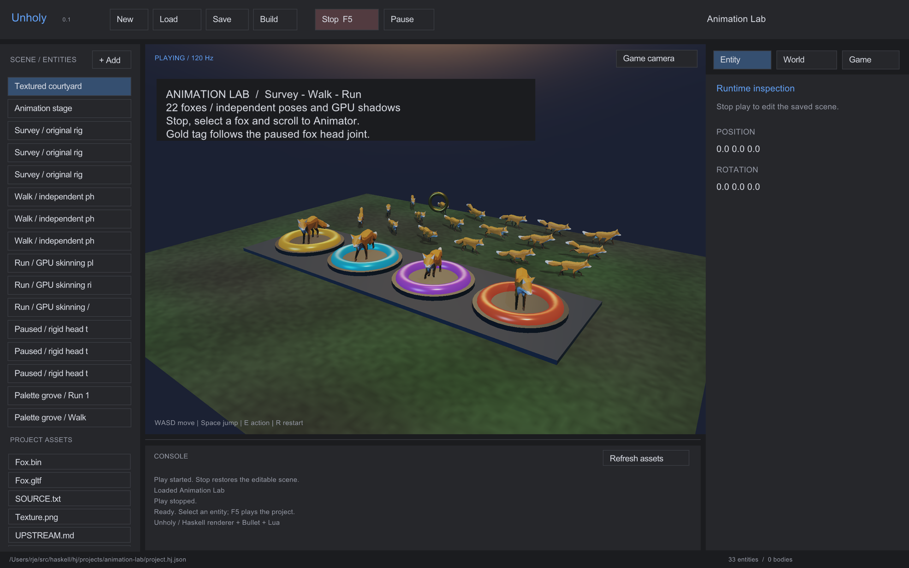

# Animation Lab

Load **Animation Lab** in the editor and press **Play**. The four front plinths
show Survey, Walk, Run and a paused pose; the rear grove has 18 more foxes with
independent phases and rates. Watch the legs, tails and their moving shadows.
The gold tag on the right fox is a rigid mesh parented to its head joint.

Press **Stop**, select a fox in the hierarchy and scroll the inspector to
**Animator**. **Next clip** cycles the imported Run/Survey/Walk clips and resets
time. Edit time, rate, looping or pause; a paused time displays the corresponding
pose immediately. Unpause the right fox to watch the rigid tag follow its head.
Save/reopen retains authored poses. Play/Stop restores the authored state.
**Build** exports a self-contained player with the rig, texture and shaders.

This demonstrates one CPU glTF asset description, conventional textured rig
import, Haskell clip/hierarchy/palette evaluation, shared immutable mesh buffers,
independent GPU deformation in material and shadow passes, conservative animated
bounds and exact picking. Ordinary rendering uploads palettes rather than CPU
deformed vertices. The scene also uses HDR environment lighting, PBR materials
and a small Lua HUD/sculpture script. It is an inspectable animation scene rather
than a character controller or a crowd benchmark.

## Assets and licenses

The Fox files come from
[Khronos glTF Sample Assets](https://github.com/KhronosGroup/glTF-Sample-Assets/tree/edc7c9e67c639d230715049ee31f9a96a6babbbe/Models/Fox),
pinned at `edc7c9e67c639d230715049ee31f9a96a6babbbe`.
Original `Fox.gltf`, `Fox.bin` and `Texture.png` are unchanged.

- Model: PixelMannen, 2014, [CC0 1.0](https://creativecommons.org/publicdomain/zero/1.0/).
- Rigging and animation: tomkranis, 2014,
  [CC BY 4.0](https://creativecommons.org/licenses/by/4.0/).
- glTF conversion: @AsoboStudio and @scurest, 2017,
  [CC BY 4.0](https://creativecommons.org/licenses/by/4.0/).

[Upstream attribution](assets/fox/UPSTREAM.md) and
[source details](assets/fox/SOURCE.txt) are included in exports.
`fox-with-tag.gltf` is a modified copy with an original gold cube mesh/material
attached to node 8; its original Fox portions retain the licenses above.
The cube, scene, generated studio HDR/ground texture and Lua script are original
Unholy demo assets under the repository's MIT license. `scripts/animation-lab.py`
recreates the scene and tag variant from the checked-in original Fox files.
