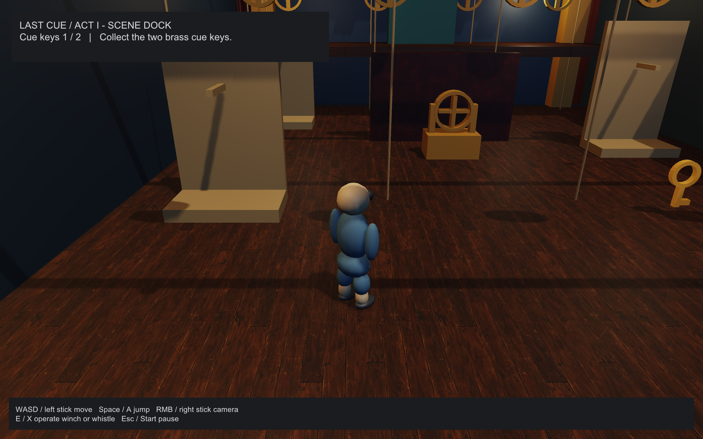
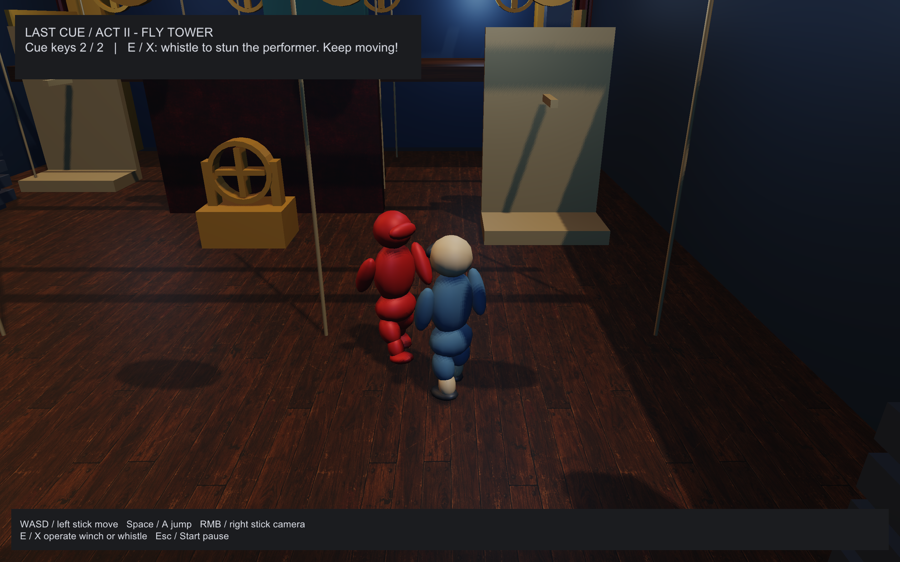

# Last Cue



A two-act backstage adventure inspired by preserved theatre machinery. Load
**last-cue** in the editor, press **Play**, then choose **New performance**.
Collect both brass cue keys, approach the central winch and engage it. Walk
around the winch, board the scenery lift when it is low, and ride to the upper
gallery's green exit. Act II adds blue worklights, fly bars, counterweights and
a mechanical performer. Keep moving; a close whistle briefly stuns it. Reach
both exits for the curtain call.



| Action | Keyboard / mouse | Controller |
| --- | --- | --- |
| Move | WASD | Left stick |
| Jump | Space | A / Cross |
| Orbit camera | Hold RMB and drag | Right stick |
| Operate winch / nearby whistle | E | X / Square |
| Pause | Escape | Start |
| Select menu item | Up / Down | D-pad |
| Confirm | Enter / Space or click | A / Cross |

The menus offer New, Continue, Pause, Save, Retry and Exit. Progress records a
named stage mark, cue keys and winch state; it never serializes transient Bullet
bodies or rewrites the authored scene. Pickups and winches save automatically.
Continue survives a fresh player process. Editor previews and exported players
use separate save namespaces under the platform's application-data directory.
`UNHOLY_SAVE_DIR` overrides the base for verification. A corrupt save produces a
visible warning; unwritable storage permits play and in-memory Retry.

This sample demonstrates Haskell-owned session UI, frame action edges,
stop-before-start level transitions with transient typed JSON payloads, atomic
checkpoints, camera-relative capsule movement, a bounded step-up motor, solid
camera/visibility queries, patrol/chase/stun/capture logic, moving platforms,
original sound effects and two-clip animation crossfades. Vertex deformation
remains on the GPU in both PBR and shadows. The mechanical performer uses
line-of-sight pursuit and short obstacle probes; it does not use a navmesh or
solve arbitrary obstacle routes. The lift is a Bullet kinematic platform.

**Stop** restores your editable entry scene after either act. **Build** includes
both level manifests and all mesh, texture, HDR and audio dependencies. The
sample's independent package is [examples/last-cue](../../examples/last-cue/README.md).

```sh
make app
./build/unholy projects/last-cue/project.hj.json
cabal test last-cue-tests --test-show-details=direct
python3 scripts/verify-last-cue.py
```

The replay script uses hidden, unfocused windows and exercises the actual Load picker, both acts, Stop and Build,
then completes a relocated export and resumes it in a new process. Frame-indexed
replays run at a fixed 60 Hz; these are gameplay and rendering checks, not FPS
measurements or physical-controller qualification. Captures and logs are in
`build/verification/last-cue/`.

Original assets, generation prompts and historical research are recorded in
[ART.md](ART.md). Regenerate meshes/audio with `python3 scripts/last-cue-art.py`
and scene JSON with `cabal run last-cue -- --write-scenes projects/last-cue`.
